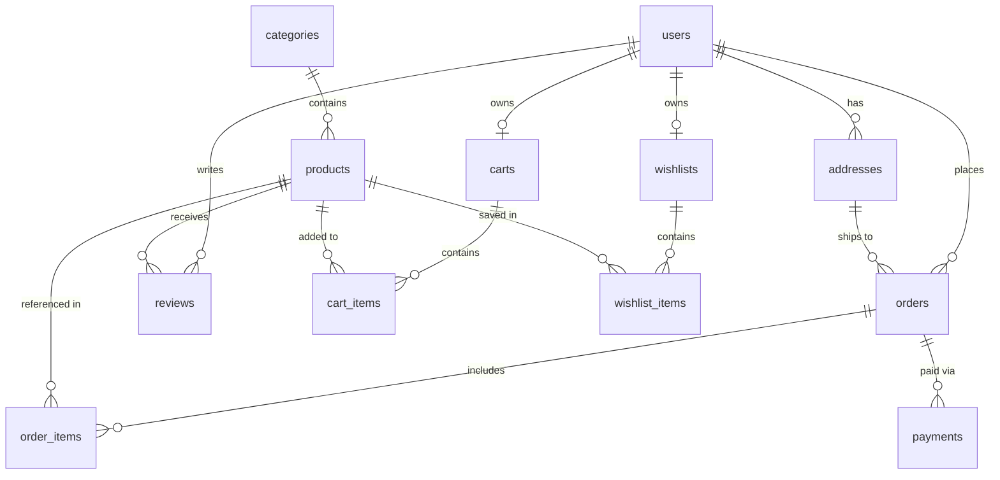

# NexCart Database Design & Architecture Guide

This document provides a comprehensive overview of the PostgreSQL relational schema, design rationale, entity relationships, constraints, and migration workflows for the **NexCart** platform.

---

## 1. Entity-Relationship (ER) Overview



---

## 2. Relational Schema & Tables

### A. Core Identity & User Accounts
- **`users`**: Stores customer and administrative accounts.
  - `id`: UUID (Primary Key, generated via `gen_random_uuid()`).
  - `full_name`: VARCHAR(100) NOT NULL.
  - `email`: VARCHAR(255) NOT NULL UNIQUE.
  - `password_hash`: VARCHAR(255) NOT NULL (bcrypt hash for Phase 3).
  - `role`: VARCHAR(20) NOT NULL CHECK (`role IN ('customer', 'admin')`).
  - `created_at`, `updated_at`: TIMESTAMPTZ NOT NULL.
- **`addresses`**: Stores customer delivery addresses.
  - `user_id`: Foreign Key referencing `users(id) ON DELETE CASCADE`.
  - Recipient, street address, city, state, postal code, and country.
  - `is_default`: BOOLEAN flag.

### B. Catalog & Products
- **`categories`**: Catalog taxonomy.
  - `name`: VARCHAR(100) UNIQUE.
  - `slug`: VARCHAR(120) UNIQUE (SEO-friendly identifier).
- **`products`**: Item listings.
  - `category_id`: Foreign Key referencing `categories(id) ON DELETE RESTRICT` (prevents deleting categories that contain active products).
  - `name`, `slug`, `description`.
  - `price`: `NUMERIC(10, 2)` exact representation (never floating-point).
  - `stock_quantity`: `INTEGER CHECK (stock_quantity >= 0)`.
  - `is_active`: BOOLEAN.

### C. Persistent Cart & Wishlist
- **`carts` & `cart_items`**:
  - Exactly one active cart per user (`user_id UNIQUE`).
  - Composite Unique constraint `(cart_id, product_id)` prevents duplicate product lines.
  - `quantity CHECK (quantity > 0)`.
- **`wishlists` & `wishlist_items`**:
  - One wishlist per user (`user_id UNIQUE`).
  - Composite Unique constraint `(wishlist_id, product_id)` prevents duplicate wishlist items.

### D. Orders & Historical Snapshots
- **`orders`**:
  - `user_id`: References `users(id) ON DELETE RESTRICT` (preserves historical order records even if user accounts are deactivated).
  - `shipping_address_id`: References `addresses(id) ON DELETE SET NULL`.
  - `total_amount`: `NUMERIC(12, 2) CHECK (total_amount >= 0)`.
  - `order_status`: CHECK (`order_status IN ('pending', 'processing', 'shipped', 'delivered', 'cancelled')`).
- **`order_items`**:
  - **Historical Snapshot Principle**: In e-commerce, product prices, titles, or descriptions change over time. When an order is created, the item's purchase price and name are explicitly captured in `product_name` and `unit_price`. Modifying the product catalog later does not alter customer invoices or past order totals.
  - `subtotal`: `NUMERIC(12, 2)` calculated at purchase time.

### E. Payments & Reviews
- **`payments`**:
  - Records payment transaction references (`provider_reference`) from providers like Stripe.
  - **Security Rule**: Raw card numbers, CVVs, and magnetic stripe data are never received or stored in our database.
- **`reviews`**:
  - Composite Unique constraint `(user_id, product_id)` ensures a user can only leave one review per product.
  - `rating CHECK (rating >= 1 AND rating <= 5)`.

---

## 3. Database Management Commands

Run from `server/`:

```bash
# 1. Check PostgreSQL and create nexcart_db if missing
npm run db:init

# 2. Apply pending versioned migrations in database/migrations/
npm run db:migrate

# 3. Seed realistic catalog data in database/seeds/
npm run db:seed

# 4. Verify tables, foreign keys, and constraint counts
npm run db:verify
```

---

## 4. Health & Readiness Probes

- **Liveness Probe**: `GET /api/health`
  - Reports HTTP 200 if Node.js process is active and running.
- **Readiness Probe**: `GET /api/health/ready`
  - Performs an active database ping (`checkDbConnection()`).
  - Returns HTTP 200 with database metadata when PostgreSQL is reachable.
  - Returns HTTP 503 Service Unavailable if the database is disconnected.